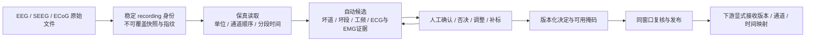

# BrainElecQC overall plan

版本：0.3，2026-10-23。由原 v0.2 实施计划收窄为独立电生理 QC；保留 S0–S9 编号便于追踪。

## 目标和当前边界

让研究者能说清楚：原始记录是什么、哪里可疑、谁作了什么决定、下游实际使用了哪些通道和时间。软件不是诊断器；大振幅、尖波和高频活动都不能直接等同伪迹。

只接 EEG/SEEG/ECoG 文件及显式通道元数据。取消当前计划的 ICA、CT/MRI、触点定位联动、空间网络/网格插值；Neuropixels 移出本轮。缺少位置时仅提供波形和名称列表，不按名称推测距离、同杆关系或 ECoG 邻接。

**已迁移：S1 非覆盖存储和 S2 保真读取，S0 的格式基线与合成合同。正在积累：真实格式与缺陷覆盖。尚未完成：S3–S6/S8–S9 产品闭环。** 独立仓库当前是 Python 核心 + CLI + 本地 HTTP + JS 二进制解码，不包含原平台完整上传/回放界面。原平台代码、上传流程和回放流程保留在原目录。

## 总流程

框图的代码生成器为 `scripts/figure_acceptance.py`；图片输出到仓库外。B–C 是已实现基础，D–H 是待完成的产品流程。

## 阶段、复用与验收

| 阶段 | 本轮状态 | 可复用 / 需要新增 | 完成判据及图形证据 |
| --- | --- | --- | --- |
| S0 夹具与格式基线 | 基线完成；真实厂商覆盖未齐 | 复用数字量、单位、重复名、混合 Fs、缺口、篡改反例；新增多格式矩阵、公开有标注样例、数据许可与本地来源清单 | 每种格式有已知数值对照和真实样例状态；图示原始通道、单位和分段。缺样例不能记为支持完成 |
| S1 recording 与输入存储 | 已迁移 | 复用 UUID、内容/清单 SHA-256、事务、幂等与不可覆盖；新增独立 DB/目录/CLI、拒绝误开别的 DB | 重名不覆盖、重复 import_key 仅精确匹配可复用、ZIP 路径安全、并发回滚、源删除后快照仍可读、搬目录后 ID/内容不变 |
| S2 保真读取与时间 | EDF/BDF 基础完成；新格式分级验收 | 复用精确 EDF/BDF/NPY、流/段/事件、EPHY 二进制；新增独立 registry、BrainVision 直接读取与可选 MNE adapters | 数字量精确一致；V 换算误差界限明确；重复名不合并、逆序窗口不改序、不跨缺口。原始与读取后波形同轴重叠，误差图与时间轴图 |
| S3 决定与执行闭环 | 待实现 | 复用 artifact/父版本追溯；新增 revision、审计日志、并发基版本校验、状态机、不可变冻结和最小消费者 | 草稿不能作为 approved 发布；旧版本仍可读取；重复执行幂等；崩溃不半发布。图示审核前后及掩码差异 |
| S4 通用复核工作台 | 待实现 | 复用二进制窗口/概览；新增纯电生理界面、框选/撤销/证据卡、保存恢复、同步对照 | 切记录无串状态；刷新保留草稿；框选边界精确落样本；键盘/缩放/通道排序不改数据；真实浏览器完整路径截图 |
| S5 EEG 路径 | 演示指标存在，产品检测待实现 | 新增 EEG 分层指标与候选解释、ECG/EOG/EMG 参考证据、用户声明参考的可追溯应用；不做 ICA | 平线/噪声/工频/参考污染有独立标注对照；正常节律、尖波、高幅运动等反例保留。报告候选命中、误报和人工耗时 |
| S6 SEEG/ECoG 路径 | 待实现 | 新增类型确认、局部/共模异常、病理保护、显式双极配对和已有双极保护；删除空间依赖 | 同名不同触点不合并；坏通道传播到派生配对明确；高频/IED不能自动删；无坐标仍能完整复核和输出 |
| S7 Neuropixels | 本轮移出 | 后续评估同事成熟方案的结果接收接口 | 不把本项目 EEG 流程套在 spike sorting 结果上 |
| S8 正式下游交付 | 待实现 | 复用不可变派生与保真回读；新增 QC package、消费者校验和版本接收回执 | 下游验证 parent/hash/revision/units/time/channel mapping；拒绝过期或不完整包；导出重读一致；不将丢弃样本当零填充 |
| S9 三模态真实试点 | 已具备读入/制图样例，端到端待实现 | 新增独立人工标签和实际使用者试跑 | 三模态各覆盖坏道、坏段、ECG/EMG 可判/不可判场景；原始→候选→人工决定→下游回读四套证据；不能只有合成示例 |

## 最近执行顺序

1. 固定当前接口和格式证据；取得尼高丽 `.e` 的真实匿名样例及同次官方导出，校验极性、全部采样率、全部分段、事件与伴随文件。不能用 `.data` 验收代替 `.e`。
2. 实现 S3：先完成决定版本、审计与掩码发布，并做一个只读取明确发布版本的消费者。临时门限不先接自动删除。
3. 实现 S4 最小工作台：左通道/候选，中央波形/PSD/参考，右决定，底部分段时间轴；完成保存恢复后再增加批量操作。
4. 按 S5、S6 加三模态候选，使用独立的真实标注集评估。阈值在验证集调节，锁定后报告另一个集合，不能用调参例子报准确率。
5. 接通 S8–S9：完整下游包、实际消费回执、真实人工审核前后图。之后才实现宿主插件适配。

## 迁移取舍

- 复用的是信号/存储合同与测试，不复制原平台的大量 subject/影像/job/UI 依赖。
- 输入 `recording_id` 与派生 `artifact_id` 独立；处理结果不能修改原快照。存储搬迁不改变相对路径和身份。
- Python reader 层不依赖 Flask；持久化服务使用独立 SQLite；HTTP 和 CLI 是可替换入口。当前存储配置仍使用环境/应用上下文，未来多租户插件需再显式注入上下文，不能称为零改造集成。
- 无插件发现框架、注册中心或宿主依赖；Linxi 接口核对和待办见 [可迁移性说明](docs/portability.md)。

## 验收纪律

每次报告列出命令、退出码和实际覆盖。所有验收图、原始/合成信号文件、日志、真实样例清单均在 Git 外；仓库只放图形生成代码与通用计划。真实人工决定未发生时，审核后栏写待审核。文件保真通过不等于数据质量通过；一个读取器有适配代码也不等于全部厂商变体可用。
